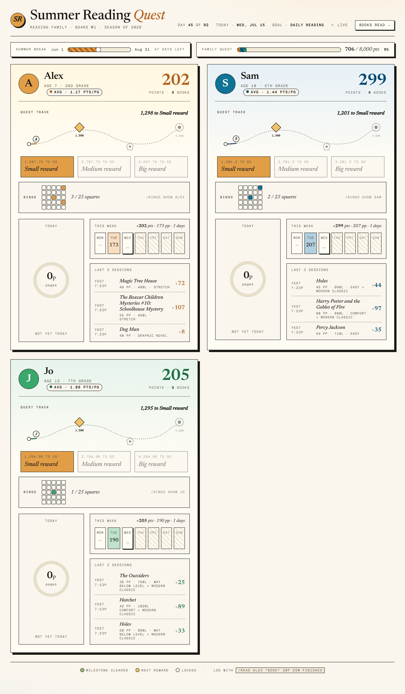
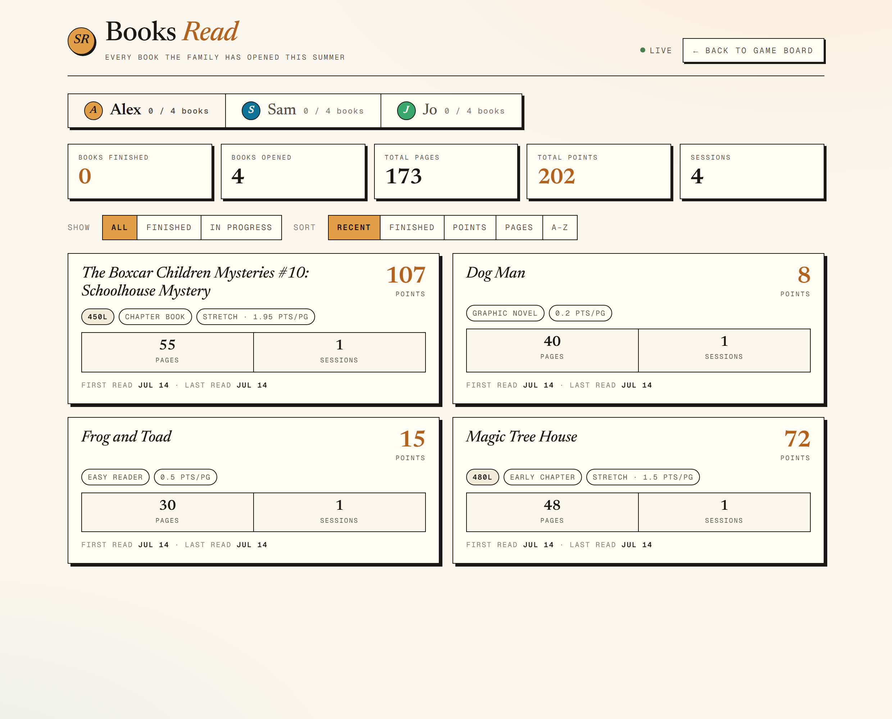
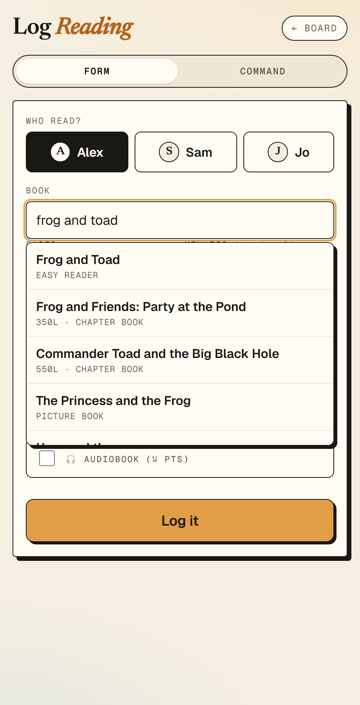

# reading-bot

A summer-reading game for families. Log what your kids read, score it by
book difficulty (Lexile) relative to *each reader's* level, and show it all on
a live game board with per-reader progress, a family points goal, streaks, and
a bingo card. Optional Mattermost slash commands and Google
Calendar sync.

It started as a two-kid household project and is built so **adding a reader is
a config edit, not a code change** — see [`reader_config_example.py`](reader_config_example.py).

## Screenshots

The live **game board** — per-reader progress, a quest track toward rewards, a
bingo card, weekly activity, and the shared family goal (shown here with three
sample readers):



The **reading library** — every book each reader has opened, with Lexile,
format, tier, points, and pages:



**Logging** from a phone or tablet at `/log` — pick a reader, search the
catalog (or add a new book), and it scores the session instantly. No Mattermost
required:




## How scoring works

Every book has a Lexile measure. Each reader is assigned a **level** — a ladder
of Lexile boundaries (defined in [`readers.py`](readers.py), `LEVELS`) that maps a
book to a tier from *way&nbsp;below* to *big&nbsp;stretch*. Points per page scale
with the tier, so a book that's an easy read for an older reader is worth more
when a younger reader stretches into it. Format (graphic novel, easy reader,
chapter book…) and a per-book density factor adjust the rate further.

Seven levels ship by default (`emerging` → `advanced`); two readers can share
one, and you can tune the boundaries or add your own.

## Quick start

No clone or build needed — the published image (`amd64` + `arm64`) already
contains the app, the board UI, and the full book catalog. Just create a
`docker-compose.yml`:

```yaml
services:
  reading-bot:
    image: ghcr.io/mcrommert/reading-quest:latest
    ports:
      - "8602:8602"
    volumes:
      - ./data:/data     # persists reading.db across restarts + image updates
    restart: unless-stopped
```

then:

```bash
docker compose up -d
```

Open **http://localhost:8602/board/** — it runs with two sample readers out of
the box.

### Use your own family

Create a `reader_config.py` next to the compose file (schema in the next
section), then mount it — your data stays on your machine, never in the image:

```yaml
    volumes:
      - ./data:/data
      - ./reader_config.py:/app/reader_config.py:ro
```

`reader_config.py` is gitignored and never baked into any image.

### Build from source instead

Prefer to hack on it?

```bash
git clone https://github.com/mcrommert/reading-quest.git
cd reading-quest
cp docker-compose.example.yml docker-compose.yml   # then uncomment `build: .`
docker compose up -d --build
```

Or without Docker:

```bash
pip install -r requirements.txt
uvicorn app:app --host 0.0.0.0 --port 8602
```

## Configuring readers

Copy the example and edit `reader_config.py` (gitignored, so your family's real
data never gets committed):

```python
READERS = [
    {"key": "alex", "name": "Alex", "monogram": "A", "age": 7,
     "grade": "2nd grade", "level": "developing", "aliases": ["a"],
     "card": "younger"},
    {"key": "sam",  "name": "Sam",  "monogram": "S", "age": 10,
     "grade": "5th grade", "level": "capable", "aliases": ["s"],
     "warn_upper_grade": True, "card": "older"},
]
```

Each reader gets scoring, name resolution (key / name / aliases), a bingo card,
board presence, and a share of the family goal automatically.

**Bingo cards.** `"card"` picks a shipped set — `"younger"` or `"older"`, named
for a reading stage rather than a particular child, so any reader can use either.
Omit it and the reader gets a card generated from a default template, which works
immediately for manual checking but auto-detects nothing. To write your own
squares, supply them inline instead:

```python
{"key": "kim", "level": "growing", "cards": {1: [
    ("KIM_PILLOW_FORT", "Read in a pillow fort"),
    # ... exactly 25 squares, with FREE at index 12 (the centre) ...
    ("KIM_BIG_DAY", "Read 100 pages in one day",
     {"daily_pages": {"gte": 100}, "prose_only": True,
      "reason": "Read {daily_pages} pages today"}),
]}}
```

A square is `(id, label)`, optionally with a third element describing when it
auto-checks. Conditions are ANDed; `prose_only` excludes illustrated formats from
page milestones. Available conditions: `daily_pages`, `session_pages`,
`book_total_pages`, `books_finished_week`, `books_finished_total` and
`days_to_finish` (each taking `gte` / `lte`), plus `finished`, `finished_format`,
`finished_genre`, `finished_classification` and `finished_award`. An unrecognised
condition raises rather than silently never firing.

Square IDs are the storage key for checked squares, so renaming one abandons its
saved state. Cards are validated on load: exactly 25 squares, unique IDs, one
FREE at the centre.

### Upgrading from 1.x

Two breaking changes:

- Readers need a `"card"` key to keep a hand-authored bingo card. Without one
  they fall back to a generated card and previously checked squares no longer
  appear on their grid. The app logs a warning naming the reader.
- Per-book point overrides in `books.json` moved from `{reader}_ppp_override` to
  `"ppp_override_by_level": {"developing": 0.4}`, so an override written once
  applies to any reader at that level instead of only to a reader with that exact
  key. The old form is still read as a fallback.

The `/alexa` endpoint has been removed.

## Endpoints

| Path | Purpose |
|---|---|
| `/log` | **Log reading from the browser** — mobile-friendly form + command bar |
| `/board/` | Desktop game board |
| `/board/ipad` | iPad kiosk view |
| `/library/` | Books-read library |
| `/board.json`, `/library.json` | Raw data |
| `/slash/read`, `/slash/reading`, `/slash/book`, `/slash/bingo` | Mattermost slash commands (optional) |

## Logging reading

Open **http://localhost:8602/log** on a phone or the kitchen tablet. Pick a
reader, search the catalog (or add a new book), enter pages, and submit — it
scores the session instantly and updates the board. A command bar accepts the
same shorthand for power users (and the Mattermost `/read` command takes it too):

```
alex "Frog and Toad Are Friends" pages=30 finished
alex "Frog and Toad Are Friends" on page 85 min=20
```

`pages=25` is how many pages you read. `on page 85` is the page you are *on*; it
logs only the pages past what is already recorded for that book (see below).
Accepted position forms (case-insensitive): `on page 85`, `on pg 85`, `on p 85`,
`on p. 85`, `at page 85`, `at=85`, `on=85`. `page=85` and `p=85` still mean pages
read. Give one or the other, not both. On the web form, choose **Pages read** or
**Page I'm on** above the number box.

Mattermost slash commands are an **optional** extra input
paths — everything works from the browser with nothing else installed. Set
`LOG_PIN` to require a PIN before logging (recommended if the app is reachable
from outside your home network).

### Position logging (`POST /api/log` with `page`)

For automated clients (e.g. a Kindle sync) that know the print page a reader is
*on* rather than how many pages they read this sitting. People use the same mode
through `/read ... on page N`, the command bar and the web form's "Page I'm on"
choice; those entries share the day's `source='position'` row with the
scrobbler (label `mattermost` or `web`), so a typed position and a Kindle sync on
the same day reconcile. Same PIN check as the
other modes (`X-Log-Pin` header or `pin` in the body). Triggered when the JSON
body has `page` and no `command`:

```json
{"reader": "michael", "book_key": "sw-jedi-apprentice-the-fight-for-truth",
 "page": 68, "minutes": 87, "date": "2026-11-25",
 "finished": false, "audiobook": false, "source": "bookorbit"}
```

- `book_key` is required (no title matching); an unknown key is a 400. `pages`
  is not used. `page` is an integer 0-5000 (absolute position), `minutes` an
  integer >= 0 (absolute total for that book on `date`), `date` parses like the
  other modes and may not be in the future, `source` is an optional label
  (default `auto`, max 40 chars).
- reading-bot keeps **one automatic row per reader, book and day**
  (`sessions.source = 'position'`, label in `source_label`; a partial unique
  index enforces it). `other` is the sum of `pages` on every *other* row for
  that reader and book (all dates and seasons, manual rows included, never
  modified), counting only rows with the same audiobook flag as the day's
  automatic row. The row's pages are `max(existing, page - other)`, so a
  position that moves backwards never removes pages. Minutes are
  `max(existing, minutes)`; `finished` is sticky. Points are recomputed from the
  row's total pages; `season` is set on insert and left alone on update.
- Typed entries differ in two ways. Minutes are **additive** (`min=20` means 20
  more minutes; the scrobbler's are the day's absolute total), selected with
  `"minutes_mode": "add"` (default `"max"` when `book_key` is sent). And the book
  may be given as a typed `book` (with `format`/`lexile` for a new one, same
  `needs` reply as the pages path) instead of `book_key`. A typed post that adds
  no pages still records its minutes, and the response carries a `message`
  such as "Already logged 68 pages of The Fight for Truth; page 60 adds nothing."
- Everything happens in one transaction. A post that changes nothing (or has no
  row and nothing to log) returns `{"ok": true, "logged": false, "pages_added": 0, ...}`
  and runs no side effects. A post that only raises `minutes` updates the row
  quietly. Milestones, family goal, bingo and calendar updates run only when
  the row gained pages or the book just became finished. `pages_added` greater
  than 2000 in one post is a 400.
- Response: `ok`, `logged`, `pages_added`, `row_pages`, `page`, `other_pages`,
  `session_id`, plus `reader`, `book_title`, `minutes`, `finished`, `audiobook`,
  `session_date`, `events`, and (when something was written and awarded) `ppp`,
  `points`, `daily_pages`, `week_pts`, `total_pts`, `backdated`.

## Configuration

All configuration is via environment variables — see [`.env.example`](.env.example).
Everything is optional; with nothing set, the bot runs standalone with no
external integrations. Data persists in a SQLite file at `DB_PATH`
(default `/data/reading.db`).

## Known limitations

- The bundled book catalog ([`books.json`](books.json)) is one family's list —
  useful as a starting point; add your own with `/book`.

## License

MIT — see [LICENSE](LICENSE).
